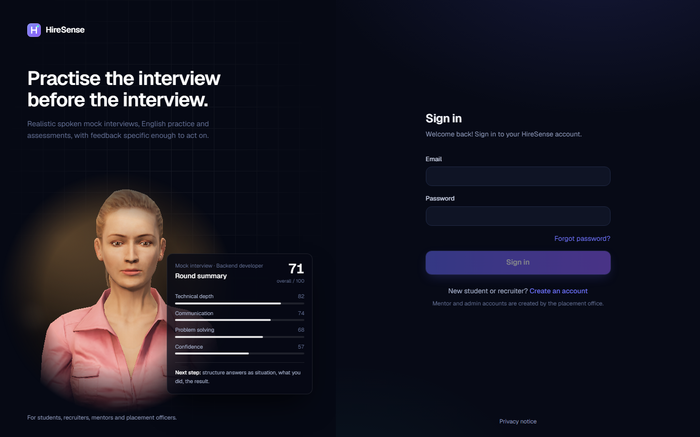
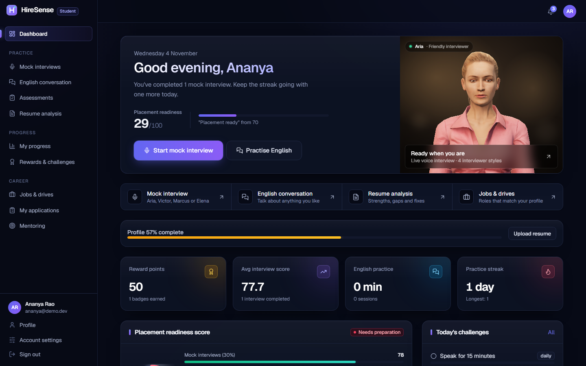
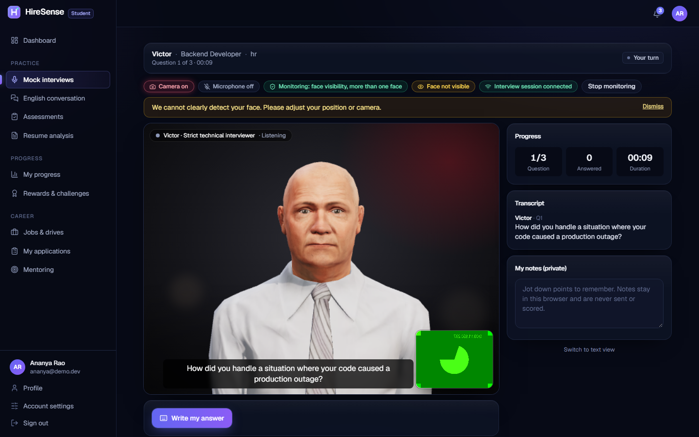
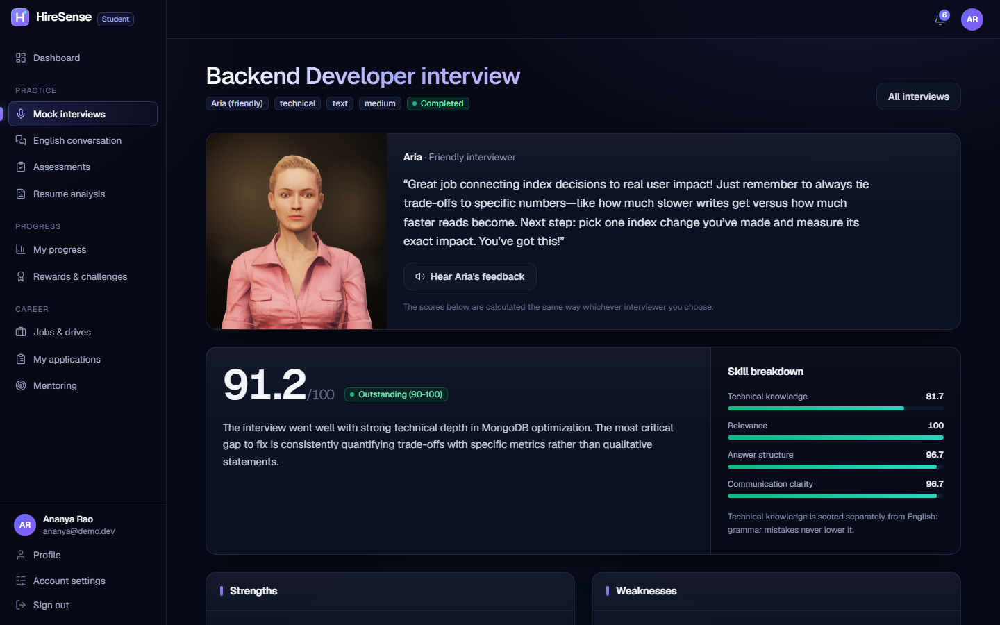
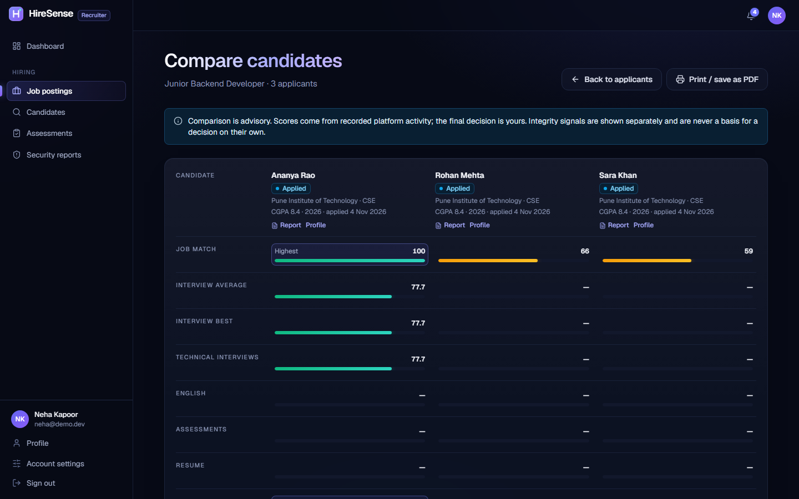
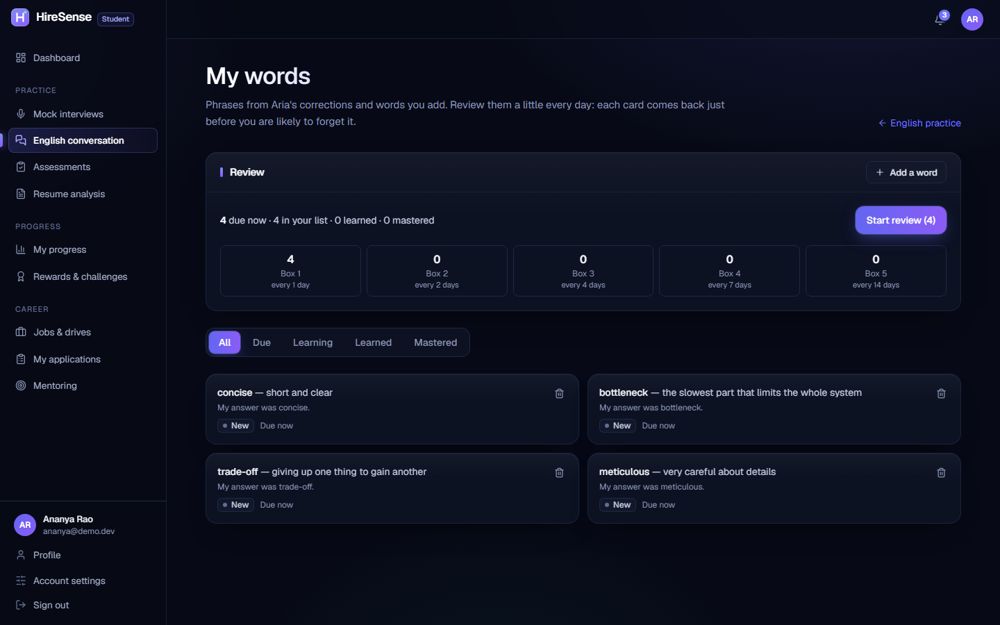
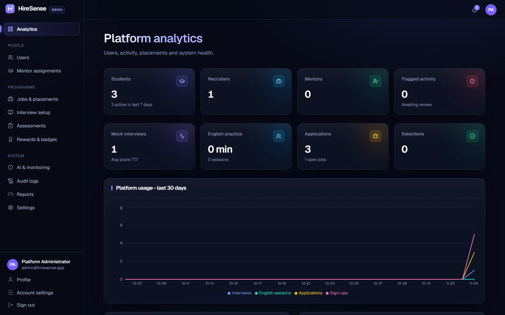
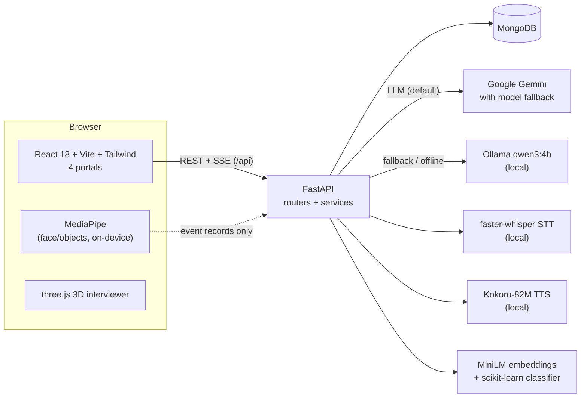

# HireSense

**An AI placement-preparation platform: students practise with a speaking 3D interviewer, recruiters compare
candidates with explainable scores, mentors track progress, and admins run the whole placement drive.**

HireSense ("AI-Powered Intelligent Interview and Placement Assessment System") is a full-stack web app with four
portals (**Student, Recruiter, Mentor, Admin**) on one FastAPI backend and MongoDB database. The language model is
Google Gemini by default, with a local Ollama model as automatic fallback, or as the only provider if you want
nothing to leave your computer. Speech recognition, the interviewer's voice and camera monitoring run locally.

The original requirements are in [PROJECT_SPEC.md](PROJECT_SPEC.md).

## Screenshots

| | |
|---|---|
|  |  |
| Sign-in with the live interviewer preview | Student dashboard with readiness and daily plan |
|  |  |
| Live voice interview with a 3D interviewer and live captions | Question-by-question report with score bands |
|  |  |
| Recruiter: candidates side by side | English: spaced-repetition word review |
|  | |
| Admin analytics | |

## Features

### Student
- **Resume analysis** (PDF/DOCX): skills, projects, experience, strengths, gaps and a readiness score. Every item the
  model returns is checked against the resume text, and anything invented is removed.
- **Mock interviews**, typed or **live voice** with one of four 3D interviewers (Aria, Victor, Marcus, Elena), each
  with their own style, voice and follow-up strategy. Questions come from the student's own resume, adapt in
  difficulty, avoid repeats (by meaning, not just wording) and react to vague answers.
- **Scoring with a calibrated rubric**: relevance, correctness, completeness, clarity and communication, fixed rule
  caps, and a band ("Strong 75-89"). Scores are identical whichever interviewer you pick.
- **English practice with Aria**: spoken or typed conversation in three learning modes, gentle corrections, topic
  memory, a recurring-mistake profile, **spaced-repetition vocabulary review**, a **daily plan** and a progress view.
- **Assessments** (timed MCQ, server-graded), **jobs and placement drives** with eligibility checks and instant
  explainable job matching, **applications** with status history, **mentoring**, **points, badges, streaks and
  challenges**.

### Recruiter
- Post jobs, screen applicants with an explainable match (required/preferred skills, meaning similarity, experience,
  and a cap so similarity can't hide a missing required skill).
- **Compare 2-4 candidates side by side** and open a **printable candidate report** (Save as PDF from the browser).
- Interview and integrity reports for their own applicants only, and only where the candidate consented.

### Mentor
- Assigned students' resumes, interviews, English sessions and assessments; feedback, private notes, improvement plans
  with goals that complete automatically, sessions, struggling-student alerts and AI recommendations.

### Admin
- Analytics, users and recruiter approval, mentor assignment, question bank, rubrics, badges, reward rules, settings,
  flagged-activity review, AI usage and speed per model, error log, audit log, interview-security settings and CSV
  placement reports.

### Across the platform
- **Live notifications** over Server-Sent Events, with a polling fallback.
- **Disclosed, on-device interview monitoring** (MediaPipe in the browser): face visible, multiple faces, approximate
  gaze, tab/fullscreen changes, paste, possible second voice, device and network interruptions. Events are signals
  only and **never change scores**.
- **AI data consent**: when the provider is Gemini, students see what is sent to Google and must agree before the
  first AI feature; there is a `/privacy` page.
- httpOnly cookie sessions, Argon2 passwords, role checks on every endpoint, login lockout and rate limits (memory or
  Redis), password reset by email (SMTP), audit logging.

## Architecture



Every model call goes through one gateway (`backend/app/services/ai_base.py`) that applies daily limits, JSON-schema
validation with one retry, and usage logging (status, latency and tokens, never the resume or answer text). If the AI
is unavailable the app says so instead of faking results: interviews fall back to the admin question bank and job
matching to keyword rules, each clearly labelled.

## Tech stack

| Layer | Technology |
|---|---|
| Frontend | React 18, Vite 6, Tailwind CSS, React Router, Recharts, three.js, MediaPipe Tasks Vision, Vitest |
| Backend | Python 3.14, FastAPI, pydantic-settings, a small MongoDB data layer with a SQLAlchemy-style API (`backend/app/odm/`, pymongo) |
| Database | MongoDB (local service, Docker, or MongoDB Atlas) |
| Language model | Google Gemini (3.5 Flash / Flash-Lite, automatic switching) or Ollama `qwen3:4b`, JSON-schema outputs |
| Speech | faster-whisper base.en (STT), Kokoro-82M (TTS), browser speech as fallback |
| ML | Sentence Transformers `all-MiniLM-L6-v2`, scikit-learn question-type classifier (`backend/ml/`) |
| Auth and security | JWT in an httpOnly cookie, Argon2, role guards, Redis-or-memory rate limiting |
| Ops | Docker, docker compose, Render blueprint, Vercel config, GitHub Actions |

## Quick start

### Windows (development laptop)

Requirements: **Python 3.12+** (developed on 3.14), **Node.js 20+**, **MongoDB Community Server** (Windows service on
`127.0.0.1:27017`), and optionally **Ollama** for local AI.

1. Copy `backend/.env.example` to `backend/.env`. For Gemini, put your key in `GEMINI_API_KEY`
   ([get one here](https://aistudio.google.com/apikey)); for fully local AI set `LOCAL_AI_PROVIDER=ollama`.
2. Double-click **`start.bat`**. It checks Python, Node.js and MongoDB, pulls `qwen3:4b` if Ollama is installed,
   starts the backend (`start-backend.bat`, API on http://127.0.0.1:8000, docs at `/docs`) and the frontend
   (`start-frontend.bat`, http://localhost:5173), then opens the browser.
3. On first setup the backend console prints a generated **admin password once** (login `admin@hiresense.app`).
   Lost it? `cd backend` then `venv\Scripts\python -m app.reset_admin`.

There are no demo accounts: students and recruiters register on the sign-up page, and the admin creates mentors. The
seed (`python -m app.seed`, safe to re-run) only adds reference data such as the question bank, rubrics, badges,
reward rules, challenges and starter assessments.

<details>
<summary>Manual setup (two terminals)</summary>

```powershell
# backend
cd backend
py -3.14 -m venv venv
.\venv\Scripts\activate
pip install torch --index-url https://download.pytorch.org/whl/cpu
pip install -r requirements.txt
pip install --no-deps kokoro==0.7.16      # local voice; see docs/VOICE_INTERVIEW.md
copy .env.example .env
python -m app.seed
uvicorn app.main:app --reload --port 8000

# frontend
cd frontend
npm install
npm run dev
```
</details>

### Docker compose

```bash
cp .env.docker.example .env.docker     # set MONGO_PASSWORD, SECRET_KEY, GEMINI_API_KEY, ADMIN_PASSWORD
docker compose --env-file .env.docker up -d --build
```

This starts MongoDB (with a password), the API in the slim cloud profile and nginx on http://localhost:8080. The
Docker images have not yet been built on the development machine, so treat this path as untested. Hosting on MongoDB
Atlas + Render + Vercel is described step by step in [docs/DEPLOY.md](docs/DEPLOY.md).

## Configuration highlights

All settings live in `backend/.env` (see `backend/.env.example`; cloud defaults in `backend/.env.cloud.example`).

| Setting | Default | Meaning |
|---|---|---|
| `LOCAL_AI_PROVIDER` | `gemini` in `.env.example` | `gemini`, `ollama` or `none` |
| `GEMINI_MODEL`, `GEMINI_BACKUP_MODELS` | 3.5 Flash, then Flash-Lite | switched automatically when a model is overloaded or slow |
| `AI_FALLBACK_TO_OLLAMA` | `true` | answer with the local model when Gemini fails |
| `STT_ENGINE` / `TTS_ENABLED` | `faster` / `true` | local Whisper and Kokoro; the cloud profile uses `gemini` / `false` |
| `MONGODB_URL`, `MONGODB_DB` | local server, `hiresense` | Atlas works with a `mongodb+srv://` URL |
| `SECRET_KEY`, `COOKIE_SECURE`, `COOKIE_SAMESITE` | dev placeholder, `false`, `lax` | the app refuses to start with a weak key when `COOKIE_SECURE=true` |
| `REDIS_URL` | empty | shared login lockout and rate limits across workers |
| `SMTP_*` | off | password-reset emails; without SMTP the link is printed in the server log |
| `AI_DAILY_LIMIT_PER_USER` | 200 | AI calls per user per day |

## Tests

| Suite | Result (2026-11-05) |
|---|---|
| Backend unit + API (`backend/tests`, mocked models, MongoDB test DB) | **358 passed, 2 skipped** (Redis-only) |
| Frontend (`npm test`, Vitest) | **141 passed** |
| Real-model checks (`backend/tests_integration`) | 14 tests on Gemini and Ollama, run by hand |
| Browser E2E (`backend/tests_e2e`, Playwright) | 14 scripts; `ci_smoke_browser.py` runs in CI |

GitHub Actions runs the backend suite, a slim cloud-profile job, the frontend tests and build, and the browser smoke
test on every push. Details and commands: [docs/TESTING.md](docs/TESTING.md).

## Measured results

- **Score calibration** on 16 hand-labelled answers (`qwen3:4b`): rank correlation with the labels 0.80 → **0.95**,
  answers scored 100 went from 5 → **0**, and poor answers average 13 (was 29).
- **Gemini speed:** answer scoring ~1.1 s, resume analysis 56 → 5.3 s, live answer → next question 1-3.8 s.
- **Speech recognition:** a 16 s answer is transcribed in 0.8 s (was 4.2-4.9 s), with live captions every ~1.2 s.
- **Frontend:** first-load JavaScript 1,130 kB → 236 kB, avatar models 16.5 MB → 5.4 MB.

See [docs/PERFORMANCE.md](docs/PERFORMANCE.md) and [docs/AI_MODELS_AND_SCORING.md](docs/AI_MODELS_AND_SCORING.md).

## Honest limitations

- **Never tested with a real person's microphone or camera.** Voice and monitoring were tested with fake devices and
  synthetic faces; detector thresholds still need tuning on real sessions.
- **Scores are practice estimates.** The 4B local model can't reliably tell a good answer from an excellent one
  (87 vs 90 on average), and a small model can occasionally mark a wrong MCQ option, so AI-drafted questions are always
  author-reviewed.
- **Gemini quota:** on a free key, `gemini-3.5-flash` returned HTTP 429 for most requests; the app then used
  Flash-Lite or Ollama. Steady hosted use needs a paid tier or a higher quota.
- **Capacity:** with Ollama only one generation runs at a time, so simultaneous users queue. Live notifications and
  some guards are per process; use one API worker or add Redis.
- **Monitoring is a signal, not proof:** gaze is approximate, the second-voice check is a heuristic, a web page can't
  see other apps or devices, and there is deliberately no face recognition.
- No OCR (scanned image-only PDFs are rejected), English-only voice, and `espeak-ng` (used by Kokoro) is GPL-3.0; see
  [THIRD_PARTY.md](THIRD_PARTY.md).
- Docker images and the hosted deployment haven't been run on a real host yet.

## Documentation

| Document | Contents |
|---|---|
| [docs/AI_MODELS_AND_SCORING.md](docs/AI_MODELS_AND_SCORING.md) | Providers, local setup, how each AI feature works, interview engine, calibration |
| [docs/VOICE_INTERVIEW.md](docs/VOICE_INTERVIEW.md) | Live voice interview, lip sync, state machine, the four interviewers, speech recognition |
| [docs/ENGLISH.md](docs/ENGLISH.md) | English companion, vocabulary review, daily plan, progress and rewards |
| [docs/INTERVIEW_SECURITY.md](docs/INTERVIEW_SECURITY.md) | Camera monitoring, security module, risk summary, who sees what |
| [docs/ATTENTION_MONITORING.md](docs/ATTENTION_MONITORING.md) | Visual attention percentage |
| [docs/PERFORMANCE.md](docs/PERFORMANCE.md) | Latency work and measurements |
| [docs/TESTING.md](docs/TESTING.md) | Test suites, CI and commands |
| [docs/DATABASE.md](docs/DATABASE.md) | MongoDB layout, backup, file storage |
| [docs/PROJECT_STRUCTURE.md](docs/PROJECT_STRUCTURE.md) | Folder and file guide |
| [docs/DEPLOY.md](docs/DEPLOY.md), [docs/DEPLOYMENT_READINESS.md](docs/DEPLOYMENT_READINESS.md) | Hosting guide and readiness checklist |
| [docs/FEATURE_STATUS.md](docs/FEATURE_STATUS.md) | What is done, verified or not built |
| [docs/AI_MODEL_INVENTORY.md](docs/AI_MODEL_INVENTORY.md) | Every model used, with licence |

API reference: run the backend and open http://127.0.0.1:8000/docs (Swagger) or `/redoc`.

## Licence

MIT, see [LICENSE](LICENSE). Third-party models and assets keep their own licences: [THIRD_PARTY.md](THIRD_PARTY.md).
